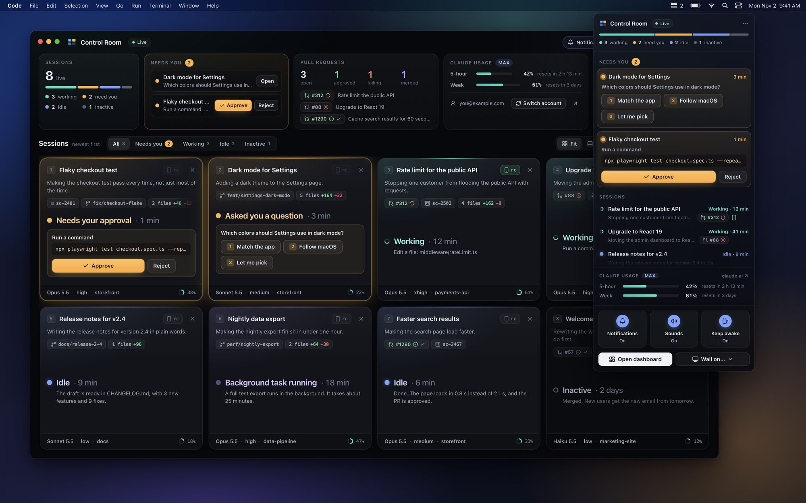
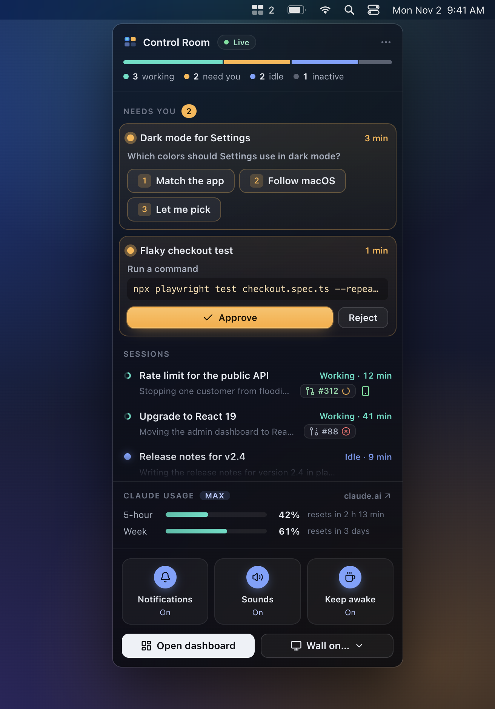
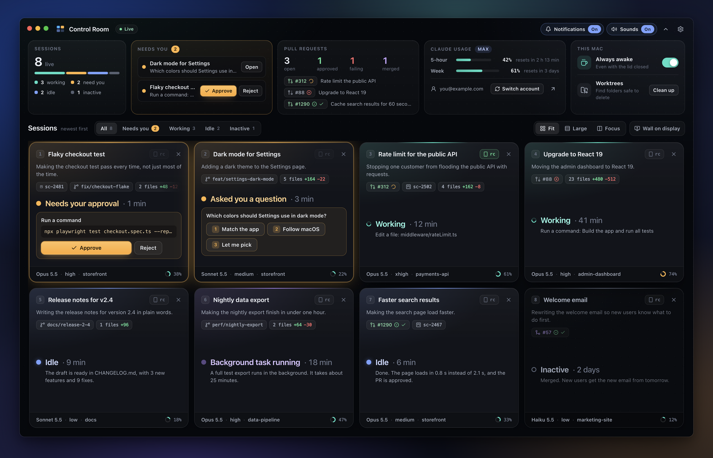
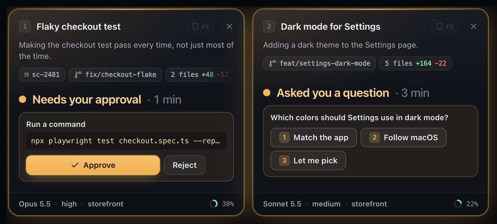
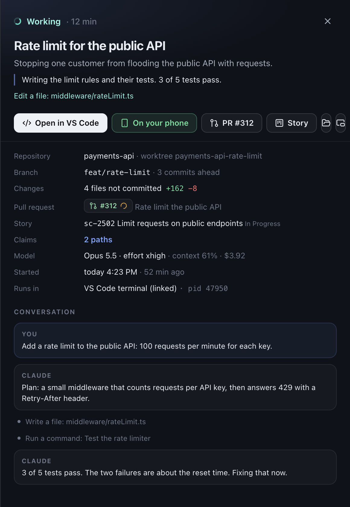
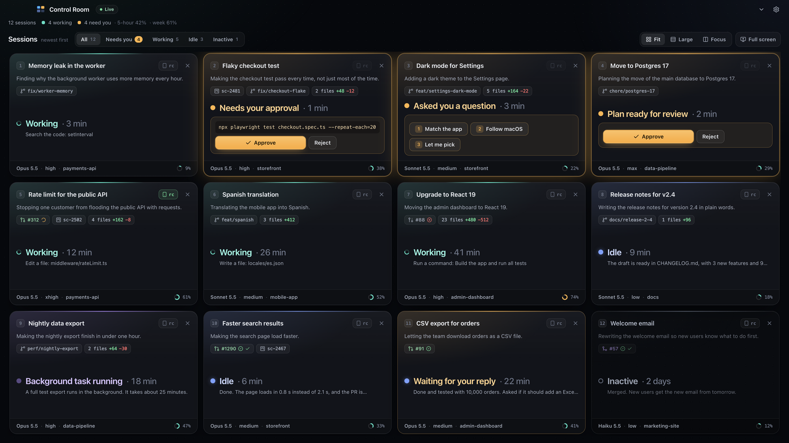
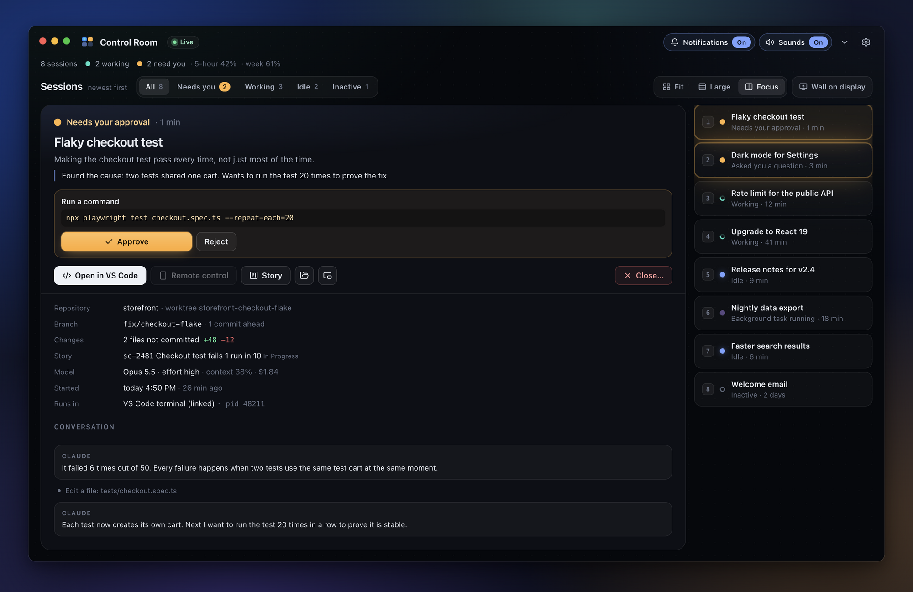
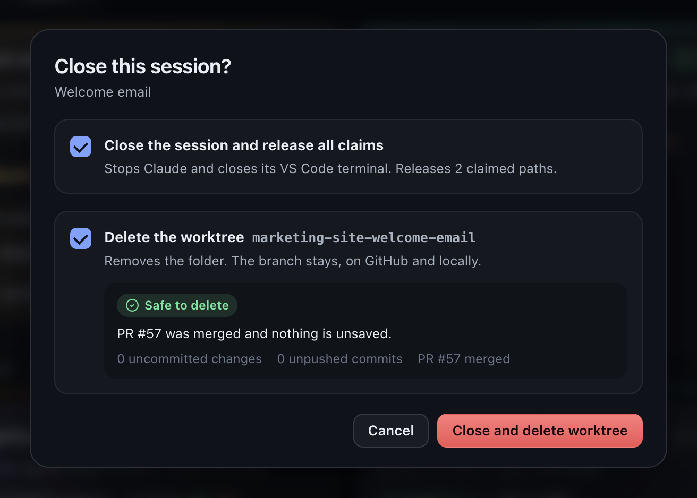
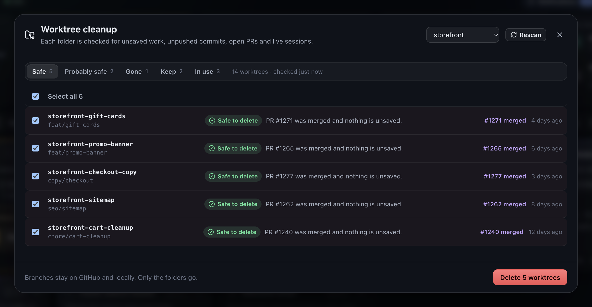

<p align="center">
  
</p>

<h1 align="center">Control Room</h1>

<p align="center">
  <b>Every Claude Code session on one screen.</b><br>
  See which one needs you, and answer it right from your menu bar.
</p>

<p align="center">
  
  
  
</p>

<p align="center">
  
</p>

<p align="center"><sub>Real screenshots of the app. The sessions are samples from <code>npm run demo</code>.</sub></p>

---

You run five Claude Code sessions. You switch to email for a minute.
One session asks for permission. Another one asks you a question.
Forty minutes later, both are still waiting for you.

**Control Room fixes this.** It lives in your Mac's menu bar and watches every session for you.
When a session needs you, you see it right away, and you answer with one click.
No more searching through terminal tabs.

## What you get

- 🔍 **It finds every session.** Start `claude` in any terminal, and it shows up a moment later.
- 🚦 **Live status in plain words:** working, needs your approval, asked you a question, waiting for your reply, idle, inactive.
- ✅ **Approve, reject and answer** from the dashboard or from the menu bar. You see the exact command first.
- 📱 **Take a session to your phone.** Click **rc** on its tile, and the session shows up in the Claude app. It keeps running on your Mac.
- 🗣️ **Plain-English summaries.** Each session says what it works on in one short sentence. Anyone on the team can read it.
- 🔀 **Git and GitHub on every tile:** branch, changes, pull request, checks and review.
- 📊 **Your Claude usage:** the 5-hour and weekly limits, with their reset times.
- 🖥️ **Made for many screens.** Put a wall of sessions on any display, or pop one session out to its own window.
- 🔔 **Alerts with on/off switches:** desktop notifications and a soft chime.
- 🧹 **Safe cleanup.** Close a session and delete its worktree, with clear advice about unsaved work.
- ☕ **Keep awake.** One switch keeps your Mac awake, even with the lid closed, so long runs can finish.

> [!TIP]
> **Want to look first?** Run `npm install && npm run demo`, then open http://127.0.0.1:4318.
> You get the real app with sample sessions. The demo reads nothing from your Mac.

## A quick tour

### It lives in your menu bar

<table>
  <tr>
    <td width="44%"></td>
    <td>
      <p>Click the icon next to the clock. A panel opens with:</p>
      <ul>
        <li><b>Needs you:</b> each waiting session, with <b>Approve</b>, <b>Reject</b> or its answer buttons.</li>
        <li><b>Sessions:</b> everything that runs, newest first, with its PR. A green phone means the session is on your phone too.</li>
        <li><b>Claude usage:</b> your 5-hour and weekly limits.</li>
        <li><b>Quick switches:</b> notifications, sounds and keep awake.</li>
      </ul>
      <p>The number next to the icon shows how many sessions wait for you.
      Right-click the icon for a menu: open the dashboard, show the wall on a display, open at login, or quit.</p>
    </td>
  </tr>
</table>

### Every session on one screen



The overview on top counts your sessions, lists what needs you, and shows your pull requests and usage.
Below it, each session is a tile, like a monitor on a wall. Every tile has three parts:

- **Top:** the title, the **rc** button, the task in plain English, and chips for the PR, the story and the branch.
- **Middle:** the status, big and clear, with buttons when the session needs you.
- **Bottom:** model · effort · repository, and a ring that shows how full the context window is.

### Answer without leaving



An approval shows the exact command. A question shows its options as buttons.
One click sends your answer to the right terminal.
Right before it presses a key, Control Room checks the session again, so an old card can never approve the wrong thing.

### Take it with you

Leaving your desk? Click **rc** on a session's tile, or **Remote control** in its details.
Control Room types Claude Code's `/remote-control` into that session, the same command you would type yourself.
A second later, the session is in the Claude app on your phone, under **Code**, and at [claude.ai/code](https://claude.ai/code).
It keeps running on your Mac, so you can reply from your phone or from the terminal.

A green **rc** means the session is on your phone. Click it to open the session at claude.ai.
It works while Claude is busy too. Only a session that is asking you something must get its answer first.

### Plain English, for everyone

<table>
  <tr>
    <td width="48%"></td>
    <td>
      <p>Click a tile to see its details:</p>
      <ul>
        <li>what the session works on, and what it does right now;</li>
        <li>its branch, changes, pull request and story;</li>
        <li>the model, effort, context size and cost;</li>
        <li>the live conversation.</li>
      </ul>
      <p>The short summaries come from Claude Haiku, through your own <code>claude</code> command.
      They are written for people, not only for engineers.</p>
    </td>
  </tr>
</table>

### A wall of monitors, on any screen



Choose **Wall on display** to put the wall on another screen. On a display of its own, it opens full screen.
The tiles resize so every session fits, like a real control room.
To watch just one session, pop it out to its own window and drag it to any screen.

### Focus on one session



**Focus** shows one session large, with the others in a list beside it. Press `1` to `9` to switch.

### Close cleanly

<table>
  <tr>
    <td width="40%"></td>
    <td></td>
  </tr>
</table>

The **×** on a tile asks two things:

- ☑ **Close the session and release its claims.** On by default.
- ☐ **Delete the worktree.** Off by default. Next to it, you get advice: *Safe to delete*, *Probably safe*, *Keep it for now*, or *In use*. To delete work that is not saved, you must tick one more box.

**Worktree cleanup** (This Mac → Clean up) checks every worktree of a repo for uncommitted changes, unpushed commits, open pull requests and live sessions.
It deletes folders only. Your branches stay, on GitHub and on your Mac.

## Install

**You need:**

- A Mac. It is tested on macOS 15 Sequoia with Apple silicon.
- [Node.js](https://nodejs.org) 22 or newer.
- [Claude Code](https://github.com/anthropics/claude-code) (the `claude` command).
- Optional: the [GitHub CLI](https://cli.github.com) `gh`, signed in, for pull request status.
- Optional: [VS Code](https://code.visualstudio.com), to jump to a session's terminal and to answer from the dashboard.
- Optional: for **rc**, the Claude app on your phone, and Claude Code signed in with a claude.ai plan. See [Remote Control](https://code.claude.com/docs/en/remote-control).

**Build and install (about 3 minutes):**

```bash
git clone https://github.com/davidalexandrovich/claude-control-room.git
cd claude-control-room
npm install
npm run package
ditto "release/mac-arm64/Control Room.app" "/Applications/Control Room.app"
open "/Applications/Control Room.app"
```

On an Intel Mac, the app is in `release/mac` instead of `release/mac-arm64`.

The app is signed for your Mac only. That is normal for an app you build yourself, and macOS opens it without a warning.
If macOS ever blocks it, open **System Settings → Privacy & Security** and click **Open Anyway**.

**On the first start:**

- The dashboard opens, and the icon appears in the menu bar, next to the battery and Wi-Fi icons.
- **Open at login** turns on by itself, so the icon is back after every restart.
- The Dock icon shows only while a Control Room window is open. Closing the window keeps the app in the menu bar.

### Finish setup (one time)

A banner at the top of the dashboard offers two steps:

1. **Connect Claude Code.** This adds a status line and a quiet `PermissionRequest` hook to `~/.claude/settings.json`. It saves a backup first.
   With them, the dashboard knows your usage limits, the model, the effort, and what each approval asks.
   The status line also shows `model · effort · context · 5h · week` in your terminal.
   **Settings → Claude Code → Disconnect** removes both and gives your old status line back.
2. **Install the VS Code helper.** This is a tiny local extension. It tells the dashboard which VS Code terminal runs which session.
   Then **Open in VS Code** shows the right terminal, and Approve, Reject and answers work from the dashboard.
   If a VS Code window does not connect within a minute, run **Developer: Reload Window** in it. Your terminals survive the reload.

You can also do these later, in **Settings**:

- **Shortcut:** paste an API token to see story names and states. The app finds `sc-12345` in the branch, a note or the chat.
- **Keep awake without a password:** the switch runs `pmset`, so macOS asks for your password each time. Settings shows one sudoers rule that allows only these two commands.
- **AI summaries:** on by default. You can turn them off.

### Update

```bash
git pull && npm install && npm run package
```

Then quit Control Room (right-click the icon → **Quit**), copy the new app over the old one, and open it again:

```bash
rsync -a --delete "release/mac-arm64/Control Room.app/" "/Applications/Control Room.app/"
open "/Applications/Control Room.app"
```

### Uninstall

1. In the dashboard, open **Settings → Claude Code → Disconnect**. This puts your old status line back.
2. Right-click the menu bar icon. Turn off **Open at login**, then choose **Quit**.
3. Delete `/Applications/Control Room.app`.
4. Optional: delete `~/.claude-control-room` (settings and small caches) and `~/Library/Application Support/Control Room`.
5. Optional: in VS Code, uninstall the extension **Control Room Bridge**.

## Everyday use

| To… | Do this |
|---|---|
| See what needs you | Click the menu bar icon. |
| Open the dashboard | Click **Open dashboard** in the panel, or press ⌘ Space and type "Control Room". |
| Put the wall on another screen | Click **Wall on…** in the panel, or **Wall on display** in the dashboard. |
| Watch one session on its own | Click the pop-out button on its tile. |
| Continue a session on your phone | Click **rc** on its tile. Then open the Claude app and tap **Code**. |
| Move the icon | Hold ⌘ and drag the icon along the menu bar. |
| Quit | Right-click the icon and choose **Quit**. |

<details>
<summary><b>Keyboard shortcuts</b></summary>

<br>

| Key | Action |
|---|---|
| `1` – `9` | Select a tile |
| `←` `→` | Move between tiles |
| `↵` | Open the selected session in VS Code |
| `Space` | Show or hide its details |
| `A` / `R` | Approve or reject |
| `P` | Open its pull request |
| `X` | Close the session |
| `F` | Switch to Focus |
| `Esc` | Close panels |

Keys typed right after the window gets focus are ignored. So typing meant for another app cannot approve anything.

</details>

<details>
<summary><b>How it works</b></summary>

<br>

There is no database and no cloud service. About once a second, the app reads:

| Source | What it gives |
|---|---|
| `~/.claude/sessions/<pid>.json` (written by Claude Code) | which sessions are alive, their status, why one waits, and whether Remote Control is on |
| the process table | that each session is still a running `claude` process, and its terminal |
| the transcript `~/.claude/projects/…/<session>.jsonl` | the conversation, the current tool call, the title, PR links. It reads only the new bytes each time. |
| the status line tap | model, effort, context size, cost and usage limits |
| the permission hook | what a waiting approval or question asks |
| `git` and `gh` | branch, changes, pull request, checks and review |
| `<repo>/.git/*-sessions.json` (optional) | worktree claims, if your repo keeps a registry of which session works where |
| the Shortcut API (optional) | story names and states |

The one-line summaries come from one short call to Claude Haiku, through your own `claude` command.
Each call costs about 0.03¢, and it runs only when a session has moved on.

**rc** types into the session's terminal, the same way Approve does: through `tmux`, or through the VS Code helper.
First it clears anything you typed there but did not send. Press `Ctrl+Y` in that session to get it back.
Then it types `/remote-control` and presses Enter.

</details>

<details>
<summary><b>Privacy and safety</b></summary>

<br>

- The app's server listens on `127.0.0.1` only. Other computers cannot reach it.
- It checks the `Host` and `Origin` of every request. Every action also needs a header that a web page from another site cannot send.
- Approve, Reject and **rc** read the session's status again right before they press a key. **rc** never types into a session that is asking you something.
- Shortcut tokens stay in `~/.claude-control-room/config.json`. The page only ever sees their last four characters.
- The only calls that leave your Mac are: GitHub, through your own `gh`; Shortcut, only if you add a token; and your own `claude` command, for your account status and the short summaries.
- After **rc**, Claude Code itself shares that session with your claude.ai account, as `/remote-control` always does. Control Room sends nothing there.
- The app keeps its own settings and caches in `~/.claude-control-room/`. The only change it makes to Claude Code is the status line and hook in `~/.claude/settings.json`. You add them with **Connect** and remove them with **Disconnect**.

</details>

<details>
<summary><b>Troubleshooting</b></summary>

<br>

**I can't see the menu bar icon.**
On a MacBook with a notch, macOS hides icons that do not fit. Hold ⌘ and drag the icon to the right, or quit another menu bar app.

**Approve and Reject are grey.**
The dashboard needs a way to type into the session's terminal. Install the VS Code helper, or run the session inside `tmux`. Until then, use **Open in VS Code**.

**rc does not work.**
- *Can't type in this terminal:* rc needs the VS Code helper, or a session that runs in `tmux`. In other terminals, type `/rc` yourself.
- *Did not connect:* look at the session. The first time, Claude Code asks you there to confirm Remote Control.
  It also needs a claude.ai login, not an API key. On Team and Enterprise plans, an admin must turn Remote Control on first.

**An approval card shows no command.**
That session started before you connected Claude Code. Sessions you start after connecting show everything.

**Usage says "no data yet".**
Connect Claude Code, then send a message in any session. The status line reports your limits after the next reply.

**Keep awake asks for my password.**
`pmset` needs admin rights. Add the sudoers rule that **Settings → Keep awake** shows, and the switch works without a prompt.

</details>

## Develop

```bash
npm install
npm run demo         # the UI with sample sessions, at http://127.0.0.1:4318
npm run build        # UI (Vite) + server bundle + VS Code helper package
npm run app:only     # run the Mac app from source (after a build)
npm start            # the server only, then open http://127.0.0.1:4317
npm test             # rules, parsers, settings merge, layout, helper protocol, demo
npm run typecheck
npm run package      # build release/mac-arm64/Control Room.app
npm run screenshots  # take the README pictures again, from the demo
```

The code lives in:

- `server/`: the Node server. It has no runtime dependencies.
- `web/`: the React UI.
- `shared/types.ts`: the data that the server and the UI share.
- `electron/`: the Mac app shell, the menu bar icon and the panel.
- `vscode-extension/`: the VS Code helper.
- `scripts/`: icon drawing, helper packing and the screenshot script.
- `tests/`: the tests.

---

<p align="center"><sub>Made for people who run more Claude Code sessions than they can watch. Built with Claude Code.</sub></p>
